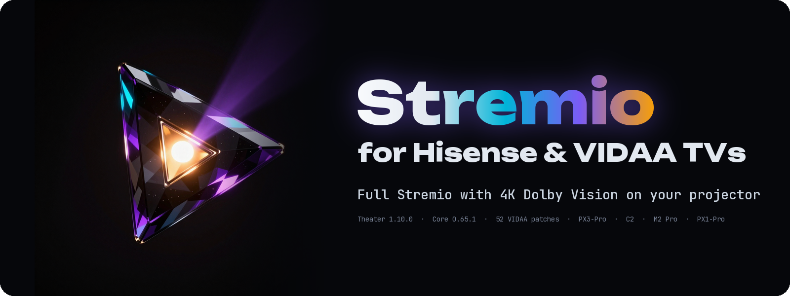

<p align="center">
  
</p>

<p align="center">
  <strong>Turn a Hisense laser projector (PX3-Pro, C2, M2 Pro, PX1-Pro) or any VIDAA smart TV into a full 4K Dolby Vision and HDR Stremio home theater in 30 seconds.</strong>
</p>

<p align="center">
  <a href="https://noobygains.github.io/stremio-vidaa-tv/"></a>
  
  
  
  
  <a href="https://github.com/NoobyGains/stremio-vidaa-tv/stargazers"></a>
</p>

<p align="center">
  <a href="#-30-second-quick-start">Quick start</a> •
  <a href="#-official-store-app-vs-this-build">Why switch</a> •
  <a href="#-4-ways-to-install">Install</a> •
  <a href="#-what-this-build-solves">Features</a> •
  <a href="#-4k-codec--dolby-vision-matrix">4K and Dolby Vision</a> •
  <a href="#-remote-control-cheatsheet">Remote keys</a> •
  <a href="#-troubleshooting">Troubleshooting</a>
</p>

## ⚡ 30-Second Quick Start

You don't need a PC, USB stick, or Developer Mode to start watching right now:

1. Open the **Internet Browser** on your Hisense Projector or VIDAA TV (*Home ▸ Apps ▸ Browser*).
2. Enter this URL and **Bookmark** it:
   ```text
   https://noobygains.github.io/stremio-vidaa-tv/
   ```
3. Sign in with your Stremio account via QR code. All your addons (**Torrentio**, **Real-Debrid**, Trakt, library) sync automatically, and the built-in Service Worker caches the entire app offline so it boots instantly next time.

> [!TIP]
> **Using a local Stremio Streaming Server?** Open `https://noobygains.github.io/stremio-vidaa-tv/?server=http://192.168.1.50:11470` (with your server's LAN IP) once — or use **Settings ▸ Server ▸ Edit URL ▸ Auto-Detect** to find it automatically on your Wi-Fi.

---

## 🔥 Official Store App vs. This Build

If you own a **Hisense Laser Projector** (`PX3-Pro`, `PX1-Pro`, `PX1HE`, `M2 Pro`, `Smart Mini C2`, `C2 Pro`, `C2 Ultra`) or **VIDAA Smart TV**, you already know the problem: the official *Stremio Lite* app in the VIDAA store is crippled, buffers after 30 seconds, and blocks community addons — while standard TV sideload guides silently fail on projector firmware.

This project takes Stremio's latest **Theater `1.10.0`** TV interface and **`@stremio/stremio-core-web@0.65.1`** Rust/WASM engine, and pairs them with a purpose-built **52-module VIDAA patch layer** engineered specifically for Hisense projectors and TVs:

| Capability | Official VIDAA Store (*Stremio Lite*) | ✨ **Stremio for Projectors &amp; VIDAA (This Build)** |
| :--- | :---: | :--- |
| **Community Addons (Torrentio, Debrid, etc.)** | ❌ Stripped / Blocked | ✅ **100% Full Addon Sync** from your Stremio account |
| **TV Search &amp; URL Keyboard Input** | ❌ Broken on many VIDAA firmwares | ✅ **Multi-layer VIDAA OSK fix** (search &amp; server fields always respond) |
| **Playback Stability (4K Remuxes)** | ❌ Stalls after 30–40s | ✅ **Stall Recovery Coordinator** + DNS/TLS preconnect + buffer tuning |
| **4K Dolby Vision + HDR10 + Atmos** | ⚠️ Crashes on wrong container | ✅ **Native 4K MKV decode** + **Yellow** button hardware player handoff |
| **Stream Compatibility Hints** | ❌ Generic *"Video not supported"* | ✅ **Exact codec diagnosis** + opt-in **Stream Compatibility Badges** |
| **Local Streaming Server &amp; Transcoding** | ❌ None | ✅ **1-Click LAN Auto-Detect**, HTTPS wildcard bridge &amp; **Blue** force-transcode |
| **Direct Live / HLS (`.m3u8`) Streams** | ❌ Fails without local server | ✅ **Plays direct `.m3u8` HLS streams natively** without a server |
| **Embedded Subtitle &amp; Audio Sync** | ❌ No embedded subtitle delay | ✅ **Live `[` / `]` embedded sub shift** &amp; **Shift+`[`/`]` audio delay** |
| **50 Interface Languages** | ❌ Stuck on English (`1.10.0` bug) | ✅ **All 50 languages switch live** + opt-in **System Font** spacing fix |
| **Projector Launcher Install (`PX3-Pro`, `C2`, `M2`)** | ❌ Silently drops `Hisense_installApp` | ✅ **Direct `websdk/Appinfo.json` registry installer** + **Sidee** + **PWA** |

---

## 🎯 4 Ways to Install

Choose the installation method that fits your setup — all four run the exact same app and patch layer:

| Method | Setup Time | Permanent Home Tile? | Requires PC? | Best For |
| :--- | :---: | :---: | :---: | :--- |
| **[1. TV Browser Bookmark](#method-1-tv-browser-bookmark-recommended-for-projectors)** | **30 sec** | Bookmark inside Browser | ❌ No | **Hisense Projectors (`PX3-Pro`, `C2`, `M2`)** &amp; zero-hassle setup |
| **[2. Sidee PIN Pairing](#method-2-sidee--permanent-launcher-tile-no-dns-change)** | **2 min** | ✅ Yes | ✅ Yes (once) | **Newer VIDAA firmware** where browser install APIs are restricted |
| **[3. One-Click Registry Installer](#method-3-one-click-dns--app-registry-installer)** | **3 min** | ✅ Yes | ✅ Yes (once) | **Direct `websdk/Appinfo.json` write** + baked server URL + verify check |
| **[4. Self-Hosted Docker](#method-4-self-hosted-docker)** | **2 min** | Bookmark / Tile | ✅ LAN Server | **Home lab / NAS users** who want 100% local LAN hosting |

### Method 1: TV Browser Bookmark (Recommended for Projectors)
> [!IMPORTANT]
> Most current Hisense projectors (`PX3-Pro`, `M2 Pro`, `C2`, `C2 Mini`) silently ignore third-party launcher tiles even when firmware APIs report success. Bookmarking in the built-in TV Browser works on **100% of models** with identical 4K DV/HDR playback and offline Service Worker caching.

1. Open the **Internet Browser** on your projector/TV (*Home ▸ Apps ▸ All Apps ▸ Browser*).
2. Go to `https://noobygains.github.io/stremio-vidaa-tv/` and press **Bookmark**.

### Method 2: Sidee — Permanent Launcher Tile (No DNS Change)
[Sidee](https://github.com/Empi9245/Sidee) registers web apps as permanent launcher tiles over the official Hisense control channel (SSDP discovery + 4-digit PIN pairing over MQTT/TLS). No Developer Mode or DNS changes needed.

1. Download [Sidee](https://github.com/Empi9245/Sidee/releases) on a PC on the same Wi-Fi and run it.
2. Click **Find TV**, then **Request code**, and enter the 4-digit PIN shown on your TV.
3. Select **Stremio** (or point `core/presets.py` to `https://noobygains.github.io/stremio-vidaa-tv/?install_source=sidee`), optionally paste your streaming server URL, and confirm.

### Method 3: One-Click DNS + App-Registry Installer
Our built-in Python installer ([`installer/server.py`](installer/server.py)) spoofs `vidaahub.com` (`+ *.vidaahub.com`) and writes Stremio directly into `websdk/Appinfo.json` via `HiUtils_createRequest` (falling back to `Hisense_installApp` when needed), with an on-disk **Verify Install** check:

```bash
git clone https://github.com/NoobyGains/stremio-vidaa-tv.git
cd stremio-vidaa-tv/installer
python server.py
```

1. On your TV, set **Settings ▸ Network ▸ DNS** to the local IP printed by `server.py`.
2. Open the TV Browser and go to `https://vidaahub.com`.
3. *(Optional)* Enter your **Streaming Server URL** (`http://192.168.1.50:11470`) to bake `&server=` directly into the launcher icon.
4. Click **Install Stremio**, then click **Verify Install** to confirm `websdk/Appinfo.json` persisted on disk.
5. Reset DNS to Automatic and **fully restart your TV** (unplug power for 10 seconds).

> [!TIP]
> **Quick-Launch Redirect (No DNS Change):** Run `python server.py --http-port 8080` and visit `http://<pc-ip>:8080/go` on the TV Browser to 302-redirect straight to `https://noobygains.github.io/stremio-vidaa-tv/?server=http://<pc-ip>:11470` without typing long URLs on the remote.

### Method 4: Self-Hosted Docker
```bash
git clone https://github.com/NoobyGains/stremio-vidaa-tv.git
cd stremio-vidaa-tv
docker build -t stremio-vidaa .
docker run -d -p 8000:8000 stremio-vidaa
```
Then open `http://<your-server-ip>:8000` on your TV.

---

## ✨ What This Build Solves

Every customization lives in **Settings ▸ Vidaa TV** and can be toggled individually.

### 🎬 Playback, 4K Recovery &amp; Stream Intelligence
| Feature | How It Works |
| :--- | :--- |
| **Stall Recovery Coordinator** | Detects playback stalls, automatically micro-seeks to unstick the hardware buffer, and surfaces an honest action card (switch source, hand off to native player, or transcode) when a remux exceeds browser throughput. |
| **Native Player Handoff (`Yellow` key)** | Hands the active stream URL to the TV's native media player via `omi_platform.sendPlatformMessage`, verifies the browser actually backgrounded, and reports honestly if your firmware ignored the call. Includes opt-in **Auto Native Player for MKV**. |
| **Opt-In Stream Compatibility Badges** | Enable **Stream Compatibility Badges** in *Settings ▸ Vidaa TV* to tag stream cards with `⚠ MP4-DV (Prefer MKV)`, `⚠ AV1 (Needs Server)` / `✓ AV1 (Server Transcode)`, `✓ MKV HDR/DV`, and `⚠ Heavy Remux (>25GB)` before pressing play. |
| **Direct HLS (`.m3u8`) Bypass** | Bypasses Stremio Video's local streaming-server `canPlayStream` probe for direct `.m3u8` URLs so live TV and HTTP HLS addon streams play immediately without a streaming server. |
| **Auto-Play Best Stream** | Opt-in toggle that scores available streams by resolution, debrid cache status (`[RD+]`, `[AD+]`, `[PM+]`), codec, file size sweet-spot, and seed count, launching the winner automatically. |
| **Playback Memory &amp; Next-Episode Prefetch** | Remembers your playback speed and volume across sessions (only from real user changes) and warms the server cache for the next episode while you watch. |

### 🌐 Streaming Server &amp; Networking
| Feature | How It Works |
| :--- | :--- |
| **Manual LAN Auto-Detect** | Inside *Settings ▸ Server ▸ Edit URL*, press **Auto-Detect** to sweep your local `/24` subnet for a running Stremio Server (`:11470`) with 32-way parallel probes. Strictly manual — never scans in the background. |
| **Automatic HTTPS Wildcard Bridge** | When an `https://` GitHub Pages session is blocked from probing an `http://` LAN server by browser Mixed Content rules, the app automatically computes Stremio Desktop's official `https://<ip>.519b6502d940.stremio.net:12470` TLS endpoint. |
| **False-"Offline" Self-Healing** | Stremio's core checks the server once on boot and sticks on *"Offline"* if it times out. Our health monitor probes `/settings` + `/heartbeat` and triggers a rate-limited `StreamingServer/Reload` as soon as the server responds. |
| **Force Transcode (`Blue` key)** | Re-loads the current stream through your configured Stremio Server as H.264 with a single button press. |

### 🔊 Subtitles, Audio &amp; Display
| Feature | How It Works |
| :--- | :--- |
| **Embedded Subtitle Delay (`[` / `]`)** | Shifts subtitles muxed *inside* MKV/MP4 containers in ±25 ms steps — filling a gap the official app doesn't cover. |
| **Full Subtitle Filenames** | Intercepts addon subtitle responses so the picker displays full release/group filenames instead of truncated language labels. |
| **Audio Sync (`Shift+[` / `Shift+]`) &amp; Stereo Downmix** | Web Audio API `DelayNode` (0–500 ms) to fix soundbar lip-sync drift, plus an opt-in surround-to-stereo downmixer with dialogue boost. |
| **720p Viewport Zoom Correction** | Automatically corrects clipped 1080p UI layouts on VIDAA projectors/TVs that report a 720p WebView viewport (`Auto`, `UI Only`, `UI + Player`, `Off`). |
| **50 Interface Languages + Opt-In System Font** | Fixes Theater `1.10.0`'s non-reactive `interfaceLanguage` getter so all 50 languages load immediately, and provides an opt-in **System Font (Fix Text Spacing)** toggle for firmware (`P0218`) with broken webfont kerning. |

### 🛡️ TV OS Hygiene, Backup &amp; Diagnostics
| Feature | How It Works |
| :--- | :--- |
| **Settings Backup URL (`?cfg=`)** | **Copy Settings Backup URL** in *Settings ▸ Vidaa TV* exports all your `stremio_*` tweaks and server URL into a bookmarkable `?cfg=<base64>` link that auto-restores after a TV cache clear. |
| **Unified Diagnostics Panel (`Green` + `Red`)** | Multi-tab modal (Device, Playback, Debug Blob, Stream Stats, Torrents) with a **Copy GitHub Issue URL** button that generates a pre-filled bug report link. |
| **Real `Hisense_Exit` &amp; Crash Guards** | Wires Exit to `Hisense_Exit()` (upstream's `window.close()` is a no-op on VIDAA), suppresses the VIDAA `F`-key fullscreen crash, and runs a UI freeze watchdog + memory pressure monitor. |

---

## 🎬 4K Codec &amp; Dolby Vision Matrix

Verified via live hardware scanning and real-world 4K playback on Hisense Laser Projector hardware (`PX1HE` / `100L5H`, MediaTek `MT9900`, VIDAA `U06.29`):

| Format / Container | Direct Browser Playback | Notes &amp; Recommendations |
| :--- | :---: | :--- |
| **H.264 / AVC (up to 4K)** | ✅ **Plays Natively** | Hardware accelerated across all profiles |
| **HEVC / H.265 (Main, Main10, 4K 10-bit)** | ✅ **Plays Natively** | Smooth direct playback via Real-Debrid |
| **4K Dolby Vision + HDR10 (MKV container)** | ✅ **Plays Natively** | Full hardware DV/HDR decode in the browser — no transcoding required |
| **4K Dolby Vision + HDR + Dolby Atmos (MKV)** | ✅ **Plays Natively** | Full Dolby Vision + eARC Atmos passthrough works out of the box |
| **Dolby Vision (MP4 container)** | ❌ **Avoid (Use MKV)** | VIDAA browser hangs or shows black screen on MP4-DV; pick an **MKV** stream |
| **VP8 / VP9** | ✅ **Plays Natively** | Hardware decode supported |
| **AV1** | ⚠️ **Needs Server** | Not decoded in hardware on most VIDAA chips; use a Streaming Server to transcode |
| **Above 4K (`4320p` / `8K`)** | ❌ **Exceeds Hardware** | Exceeds hardware decoder ceiling |
| **AAC, AC-3, E-AC-3 (Atmos), Opus, FLAC** | ✅ **Plays Natively** | All standard cinema audio codecs supported |

---

## 🎮 Remote Control Cheatsheet

| Remote Button | Action |
| :--- | :--- |
| 🔴 **Red** | Toggle verified **Stream Stats Overlay** in player (source, hash, resolution, bitrate, buffer, dropped frames, audio tracks) |
| 🟢 **Green** | Toggle **Streaming Server Health Overlay** (online status, latency, version) |
| 🟢 **Green** then 🔴 **Red** *(within 1.5s)* | Open the **Unified Diagnostics Panel** (Device, Playback, Debug Blob, Issue Link) |
| 🟡 **Yellow** | **Hand off stream to Native VIDAA Player** (with backgrounding verification) |
| 🔵 **Blue** | **Force Transcode** current stream to H.264 via your Streaming Server |
| **Info / Display** | Toggle Stream Stats / Stream Info |
| **`[`** / **`]`** | Shift **Embedded Subtitles** earlier / later (±25 ms steps) |
| **`Shift + [`** / **`Shift + ]`** | Adjust **Audio Delay** − / + (±25 ms steps, 0–500 ms) |
| **Ch+ / Ch−** | Skip forward / backward **60 seconds** |

---

## 🛠️ Repository Architecture &amp; Source Tree

The repository is cleanly organized so upstream Stremio binaries, our modular ES5 patch layer, the deconstructed readable `src/` tree, and the compiled `app/` deployment never mix:

```text
stremio-vidaa-tv/
├── app/                     # Built deployable web app (published to GitHub Pages via Actions)
├── src/                     # Deconstructed, human-readable multi-line source tree:
│   ├── theater/             #   • Theater 1.10.0 (307 main.js modules + route chunks)
│   ├── video/               #   • Stremio Video (72 modules: VidaaVideo, HTMLVideo, HLS, etc.)
│   └── core/                #   • @stremio/stremio-core-web 0.65.1 worker & WASM bridge
├── patches/                 # VIDAA patch layer (our source of truth):
│   ├── head/kernel/         #   • 10 shared kernel modules (runtime, core seam, keys, DOM, UI, etc.)
│   ├── head/<domain>/       #   • 42 feature patches (player, audio, subtitles, settings, etc.)
│   ├── chunk-edits/         #   • 17 surgical JSON find/replace edits applied at build time
│   ├── index.template.html  #   • Explicit patch execution manifest
│   └── sw.template.js       #   • Offline Service Worker + WebTorrent streaming server template
├── upstream/                # Pristine, SHA-256 hash-locked upstream Stremio artifacts (UPSTREAM.lock.json)
├── installer/               # Zero-dependency Python DNS + HTTPS + Appinfo.json registry installer
├── scripts/                 # Build (build.mjs), deconstruct (deconstruct-theater.mjs), and sync scripts
├── tests/                   # 227-test Playwright E2E & unit verification suite
└── docs/                    # Deep-dive UPSTREAM_ANALYSIS.md and SYNC.md runbooks
```

### Build &amp; Development Commands
```bash
npm ci                         # Install build & test dependencies (esbuild + Playwright)
npm run build                  # Assemble app/ from upstream/ + patches/ (verifies SHA-256 locks)
npm run deconstruct            # Format built Theater/Video bundles into readable multi-line src/ modules
npm run build:src              # Compile directly from edited src/ modules into app/
npx playwright test            # Run the full automated Playwright test suite
```

---

## ⚖️ Honest Hardware Limitations

We never ship placebo toggles or unverified claims:
- **Server-side audio track selection doesn't exist in Stremio's server API:** Verified against upstream `withStreamingServer.js` — when transcoding, the server does not accept an audio-track parameter. To switch audio tracks on incompatible containers, press **Yellow** to hand off to the native player.
- **Native handoff depends on firmware:** Some VIDAA firmware revisions ignore `omi_platform.sendPlatformMessage` play requests. Our handoff verifies whether the browser actually backgrounded within 2.5 seconds and tells you honestly if the TV ignored it.
- **Browser WebTorrent (`Settings ▸ Torrent Streaming`, off by default) only reaches WebRTC peers:** Because browsers cannot speak UDP/TCP BitTorrent, direct torrent streaming without Real-Debrid or a local Stremio Server only works on web-seeded torrents. Use **Real-Debrid** or a **Stremio Server** for normal torrents.

---

## ❓ Troubleshooting

| Symptom | Fix |
| :--- | :--- |
| **No launcher icon appears after running the installer** | Most Hisense projectors (`PX3-Pro`, `C2`, `M2 Pro`) block third-party launcher tiles in firmware even after `websdk/Appinfo.json` or `Hisense_installApp` succeeds. Use **[Method 1 (Browser Bookmark)](#-30-second-quick-start)** or **[Method 2 (Sidee)](#method-2-sidee--permanent-launcher-tile-no-dns-change)**. |
| **Projector remote has no number keys for `1234` Developer Mode** | You **do not need Developer Mode** for Method 1 (Bookmark) or Method 2 (Sidee). If you still want it: use the **RemoteNow** phone app's virtual numpad on *Settings ▸ System ▸ About*, or plug in a USB keyboard and type `1234`. |
| **Black screen with audio on a 4K Dolby Vision stream** | You selected an **MP4** Dolby Vision stream. Back out and pick an **MKV** stream (or turn on **Stream Compatibility Badges** in *Settings ▸ Vidaa TV* to flag `MP4-DV` streams automatically). |
| **"Server Offline" shown in Settings even though server is running** | On `https://noobygains.github.io`, some TV browsers block plain `http://192.168.x.y:11470` checks (Mixed Content) even while video playback works. Press **Green** to check live health, or use the `https://<ip>.519b6502d940.stremio.net:12470` HTTPS endpoint shown in the toast. |
| **Words run together / missing spaces between words** | Certain VIDAA firmware revisions (`P0218`) misrender the custom `PlusJakartaSans` webfont metrics. Enable **Settings ▸ Vidaa TV ▸ System Font (Fix Text Spacing)** (or open `?sysfont=1`). |
| **TV Browser shows a mouse pointer instead of D-pad focus** | The VIDAA Internet Browser app uses cursor navigation by default; install as a launcher tile via **Sidee (Method 2)** or **One-Click Installer (Method 3)** to run inside VIDAA's native App WebView with pure D-pad navigation. |

---

## 🤝 Credits &amp; License

- **[Stremio](https://github.com/Stremio)** — Official Stremio Theater UI &amp; `stremio-core-web` engine
- **[weinzii/vidaa-edge](https://github.com/weinzii/vidaa-edge)** — VIDAA OS API reverse-engineering &amp; `websdk/Appinfo.json` registry technique
- **[Empi9245/Sidee](https://github.com/Empi9245/Sidee)** — PIN-paired VIDAA launcher installer
- Licensed under [GPLv2](https://github.com/user-attachments/files/19851539/LICENSE.md). Unofficial community-maintained project; not affiliated with Smart Code OOD / Stremio.
